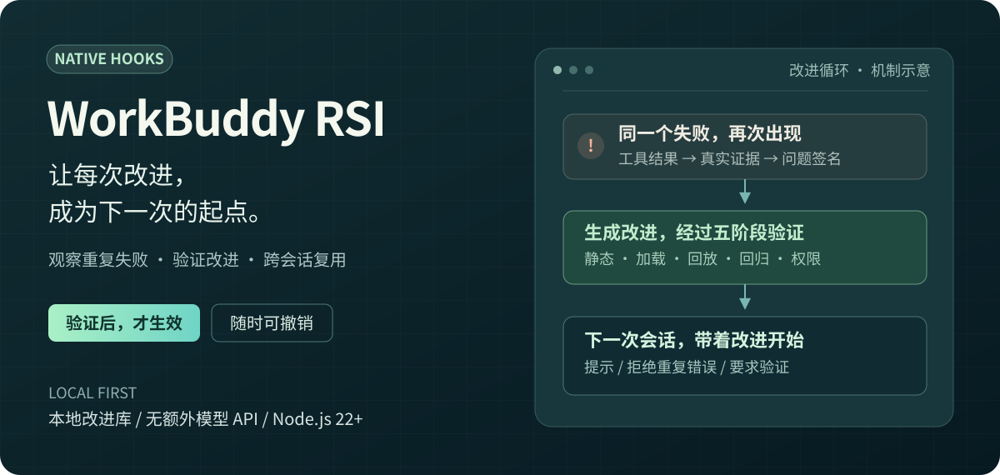
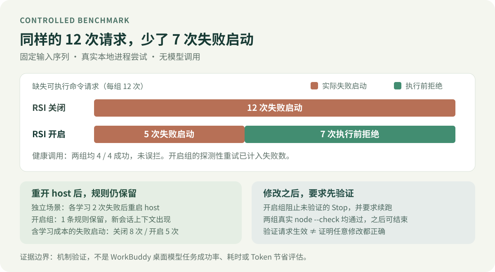
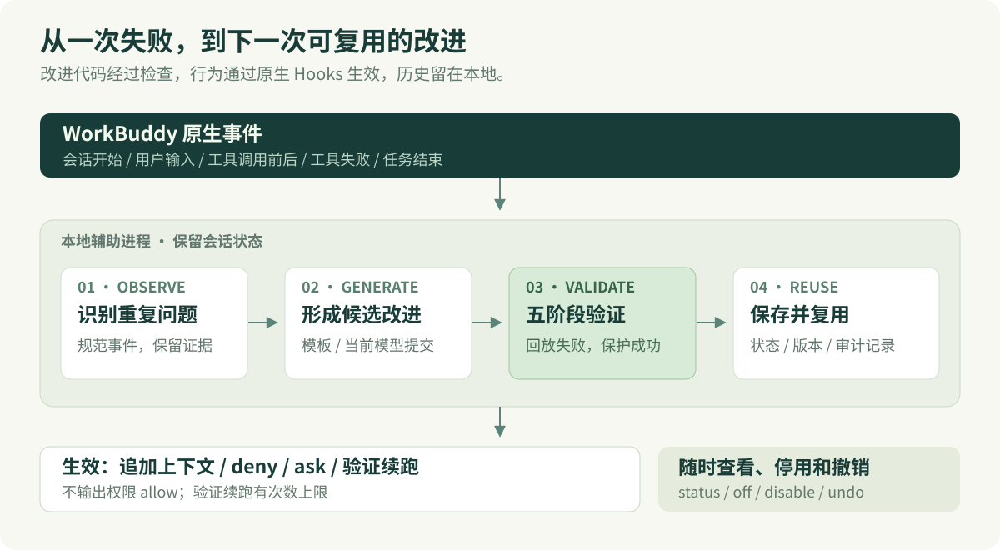

<div align="center">



# WorkBuddy RSI

### 让 WorkBuddy 从重复失败中积累可验证、可撤销的改进。

[](https://github.com/xingchenyd/dshrsi-workbuddy/actions/workflows/workbuddy.yml)
[](https://github.com/xingchenyd/dshrsi-workbuddy/releases/tag/workbuddy-v0.2.1)
[](#install)
[](#how-it-works)
[](LICENSE)

**[下载安装](#install) · [看到什么作用](#results) · [工作原理](#how-it-works) · [使用与控制](#controls) · [验证记录](#verification)**

</div>

---

WorkBuddy RSI 是面向 **WorkBuddy 桌面端**的本地自我改进插件。它通过原生 Hooks 观察工具执行中的重复问题，把改进交给五阶段验证，再将通过检查的行为保存到本地，在后续会话中复用。

默认路径无需额外 API Key，也不额外发起模型请求。需要更具体的改进时，配套 Skill 可以让 WorkBuddy 当前模型依据真实会话证据编写候选代码，经过验证和激活后使用。

> [!IMPORTANT]
> **0.2.1 是开发预览版。** 下面的效果数据来自固定测试序列和真实本地工具执行，用于验证插件机制；它们不是 WorkBuddy 真实模型任务成功率、速度或 Token 节省评估。完整测试方法与原始数据均可复现。

<table>
<tr>
<td width="33%" valign="top">

### 发现反复出现的问题

规范工具事件，识别反复失败的命令、未验证的修改等信号。改进从本机观察证据出发。

</td>
<td width="33%" valign="top">

### 通过验证，才成为改进

候选代码经过静态、加载、回放、回归和权限检查。已有成功调用也参与验证。

</td>
<td width="33%" valign="top">

### 留下来，也能撤回

改进库保存在本地。查看源代码、暂停插件、停用某条改进或撤销变更，都有明确入口。

</td>
</tr>
</table>

<a id="install"></a>

## 开始使用

**准备：** 安装支持插件 Hooks 的 WorkBuddy 桌面端，以及可从终端运行的 **Node.js 22+**。Windows 原生安装已验证；macOS/Linux 有安装路径发现逻辑与 CI 回归，尚未验证其真实桌面安装。

### 方式一：下载发行包（推荐）

1. 从 [v0.2.1 Release](https://github.com/xingchenyd/dshrsi-workbuddy/releases/tag/workbuddy-v0.2.1) 下载 **`workbuddy-rsi-0.2.1.zip`** 并完整解压。
2. 在解压目录打开终端，运行：

```powershell
node install-workbuddy.mjs --marketplace "./workbuddy-rsi-marketplace"
```

3. 打开一个 **新的 WorkBuddy 会话**，输入：

> 使用 workbuddy-rsi，查看当前状态和已经学到的改进。

安装器会调用 WorkBuddy 自带的插件管理器，验证清单、安装或更新插件，再逐文件比对 SHA256。安装成功输出包含版本、启用状态和文件校验结果。

**保留解压目录。** WorkBuddy 的本地插件市场登记了这个来源；不要只复制 `SKILL.md`，完整功能还需要包中的 Hooks 与运行代码。

### 方式二：从源码安装

```powershell
git clone https://github.com/xingchenyd/dshrsi-workbuddy.git
cd dshrsi-workbuddy
npm test
npm run build:workbuddy
npm run install:workbuddy
```

WorkBuddy 运行组件只使用 Node 标准库，以上流程 **不需要先执行 `npm install`**。

<details>
<summary><strong>先查看安装操作、只做校验，或安装到隔离目录</strong></summary>

```powershell
# 只显示安装计划，不执行
node scripts/install-workbuddy.mjs --dry-run

# 使用原生管理器校验清单，不安装
node scripts/install-workbuddy.mjs --validate-only

# 使用独立的 WorkBuddy 配置目录测试安装
node scripts/install-workbuddy.mjs --config-dir "C:/temp/workbuddy-rsi-test"
```

PowerShell 下的带参数命令直接运行 `node scripts/install-workbuddy.mjs`，避免部分 npm 脚本入口丢失参数。自动查找不到 WorkBuddy 时，用 `--cli` 指定桌面应用随附的 `cli/bin/codebuddy`。完整参数、校验方法与卸载步骤见 [安装说明](docs/workbuddy/INSTALL.md)。

</details>

<a id="results"></a>

## 它实际起了什么作用？

我们用相同的固定输入序列，分别在 RSI **关闭**和**开启**时执行，观察实际失败执行、被拒绝的重复调用、成功调用以及验证续跑。

**这里测的是工具边界上的作用。** 驱动程序刻意重复提交相同请求，不会像模型一样读提示后改换策略。因此这些数字能证明机制在所测情形下生效，不能外推为真实任务的总体收益。

<!-- controlled-results:start -->


| 实测场景 | RSI 关闭 | RSI 开启 | 这说明什么 |
| :--- | :--- | :--- | :--- |
| **同一缺失命令反复请求 12 次** | 12 次实际失败启动 | 5 次实际失败启动，**7 次执行前拒绝** | 所测序列减少了重复失败执行；仍允许探测性重试 |
| **穿插执行 4 次健康命令** | 4/4 成功，0 次误拦 | **4/4 成功，0 次误拦** | 所测健康命令未被新规则误伤 |
| **独立场景：学习后重启，再请求 6 次** | 重启后失败 6 次 | 重启后失败 3 次，拒绝 3 次 | 已保存规则可跨 host 重启复用 |
| **写入文件，尚未验证就请求结束** | 允许结束 | **要求验证后继续** | 所测 Stop 验证请求生效 |
| **真实 `node --check` 通过后再结束** | 允许结束 | 允许结束 | 所测验证流程能正常收尾 |

重启场景中，两组都先实际经历 **2 次失败**作为学习输入；计入这一成本，整个场景的失败启动为 **关闭 8 次 / 开启 5 次**。开启组保存的 1 条改进在重启后仍存在，并在本次新会话中产生了启动上下文。上下文与拒绝是否出现取决于规则与当前证据，不保证每个会话都出现。

以上数据由 Windows x64 / Node 22 的实际运行生成，每个开关条件各执行一套固定场景，没有抽样置信区间。这里的“失败”是操作系统返回的真实 `ENOENT`；“拒绝”表示工具在执行前被 Hook 挡住，并不代表原任务已完成。
<!-- controlled-results:end -->

复现实验：

```powershell
node scripts/benchmark-workbuddy.mjs
```

[实验方法](docs/workbuddy/benchmarks/README.md) · [原始结果 JSON](docs/workbuddy/benchmarks/results.json)

<a id="how-it-works"></a>

## 改进如何进入下一次会话



| 步骤 | 发生什么 | 可以检查的证据 |
| :--- | :--- | :--- |
| **观察** | 将 Bash、PowerShell、读写和编辑事件转换为一致的观察 | 工具结果、退出状态、问题签名 |
| **生成** | 自动使用确定性模板；也可由当前模型通过 Skill 提交代码 | 候选源代码与生成来源 |
| **验证** | 静态 → 加载 → 失败证据回放 → 成功历史回归 → 权限 | 每个阶段的验证报告 |
| **生效** | 通过 Hooks 注入上下文、拒绝重复失败或要求验证 | 拒绝原因、提示与状态记录 |
| **复用** | 将改进存入本地库，后续匹配会话加载 | 版本、适用范围、历史与撤销入口 |

**两条生成路径，行为不同：** 自动模板可在当前会话通过验证后挂载；模型提交的代码先保持 `proposed`，需要激活，新会话确保加载。验证器、权限规则和模型权重不会被改进代码重写。

<a id="controls"></a>

## 用自然语言管理，也能直接运行命令

在 WorkBuddy 中说：

> “使用 workbuddy-rsi 查看状态。”<br>
> “查看这条改进的代码和验证结果。”<br>
> “关闭 RSI。” / “恢复 RSI。” / “撤销最近一次改进。”

源码目录中可使用下面的命令；发行包中的同名 CLI 用法见 [安装说明](docs/workbuddy/INSTALL.md#查看和管理)。

| 操作 | 命令 | 含义 |
| :--- | :--- | :--- |
| 查看 | `npm run wb-rsi -- status` | 当前模式、会话与改进列表 |
| 审阅 | `npm run wb-rsi -- show ID` | 源代码、范围与验证报告 |
| 暂停 / 恢复 | `npm run wb-rsi -- off` / `on` | 持久停用 / 恢复 RSI 行为 |
| 停用一条 | `npm run wb-rsi -- disable ID` | 保留记录，停止应用该改进 |
| 撤销 | `npm run wb-rsi -- undo` | 回到最近一次变更前的状态 |
| 退出进程 | `npm run wb-rsi -- stop` | 关闭辅助进程；下次 Hook 会重新启动 |

模型提案流程是 **`findings → propose → 审阅 → approve`**。`propose` 从当前本地进程取得实际会话证据，不接受调用者伪造的替代验证历史。

<a id="verification"></a>

## 哪些已经验证，哪些仍待验证

| 层次 | 覆盖内容 | 证据 |
| :--- | :--- | :--- |
| **机制实验** | 固定请求下的重复失败、验证续跑、跨会话复用与成功调用保护 | [方法与数据](docs/workbuddy/benchmarks/README.md) |
| **自动回归** | **本地 189/189 通过**；覆盖核心、Hook 协议、真实子进程、IPC、持久化、提案验证和安装器 | [GitHub Actions](https://github.com/xingchenyd/dshrsi-workbuddy/actions/workflows/workbuddy.yml) |
| **平台矩阵** | Windows / Ubuntu / macOS × Node 22 / 24 | [CI 工作流](.github/workflows/workbuddy.yml) |
| **独立发行包** | 脱离源码后运行 CLI、Skill 包装器、Hook 和本地进程 | [构建回归](test/workbuddy/bundle.test.mjs) |
| **Windows 原生安装** | 清单识别、首次安装、重复安装、版本升级、安装文件 SHA256 | [安装核验](docs/workbuddy-user-install.json) |
| **真实模型任务效果** | 任务完成率、时间、Token 消耗，以及长期复用收益 | **尚未验证，不作提升承诺** |

详细历史记录见 [验证文档](docs/workbuddy/VALIDATION.md)。CI 中的工具事件是受控载荷；Node 子进程、IPC、引擎执行和文件读写是真实运行。跨平台 CI 通过不等于三种系统的 WorkBuddy 桌面应用均已实测。

## 设计边界

- **本地优先。** 默认状态目录为 `~/.workbuddy-rsi`，可通过 `WB_RSI_HOME` 修改；不需要读取 WorkBuddy 凭据或私有对话数据库。工具输入输出做尽力脱敏，运行数据可能含业务片段，不应随源码上传。
- **权限只会收紧。** 支持 `prompt / annotate / steer / deny / ask / verify`，不返回权限 `allow`；`block / rewrite / tool / exec` 在当前实现中不可用。
- **可以退出。** 验证续跑有次数上限；`off` 持久暂停，`undo` 撤销改进，`stop` 会等待本地监听器关闭。
- **持久化有明确范围。** 已保存改进在进程重启后仍保留，进行中会话的观察和处理器计数会重置。
- **验证不是无限保证。** 五阶段检查覆盖已有证据；Node VM 用于限制误用，不是针对恶意代码的强隔离边界。

<details>
<summary><strong>常见问题：安装后没变化、更新旧缓存、是否会额外收费</strong></summary>

**安装后没有看到行为变化？** 先开启新会话并用 Skill 查看状态。插件按观察到的问题触发，无问题时不会为了展示自己而额外添加提示。仅安装 Skill 文件不会注册自动 Hooks。

**为什么更新会提示版本或内容不一致？** WorkBuddy 可能复用相同版本号的缓存。安装器会核对实际文件，阻止旧代码被误报为新版本；使用新的发行版本并重新安装。

**会增加模型 API 费用吗？** 默认模板路径没有额外模型请求。通过 Skill 让 WorkBuddy 当前模型编写改进，仍属于 WorkBuddy 自身的模型使用，成本取决于所用服务。

**会学习其他项目的代码并自动上传吗？** 插件不提供自动上传机制，也不自动加载或发布 `.dsh-rsi` 项目代码；观察和改进保存在本地状态库中。

</details>

## 开发与贡献

```powershell
npm test                         # 核心与 WorkBuddy 回归
npm run test:workbuddy            # 仅 WorkBuddy 相关测试
node scripts/benchmark-workbuddy.mjs
npm run build:workbuddy           # 自包含插件与本地插件市场
```

近期计划包括真实 WorkBuddy 模型任务的配对评估、更多桌面版本的兼容性检查，以及长期改进的复用与撤销观测。以上是后续计划，未计入当前结果。

问题反馈或建议请提交到 [Issues](https://github.com/xingchenyd/dshrsi-workbuddy/issues)。

## 致谢与许可

感谢 [qybaihe/dshrsi](https://github.com/qybaihe/dshrsi) 提供的开源基础。本项目复用了其中的检测器、改进引擎、验证及存储代码，在此基础上开发 WorkBuddy 的原生事件接入、本地进程、管理技能、安装与验证流程。复用部分保留原版权与 MIT 许可，详见 [LICENSE](LICENSE) 与 [NOTICE](NOTICE)。
