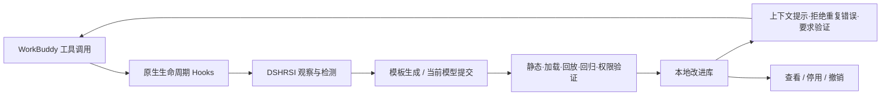

# DSHRSI for WorkBuddy

[](https://github.com/xingchenyd/dshrsi-workbuddy/actions/workflows/workbuddy.yml)

**把 DSHRSI 的可验证改进循环接入 WorkBuddy 桌面端。**

由 **yd / [xingchenyd](https://github.com/xingchenyd)** 发起并维护 WorkBuddy 适配，基于 **[qybaihe/dshrsi](https://github.com/qybaihe/dshrsi)**。保留原项目 MIT 许可及 Git 提交历史；原始介绍见 [README.upstream.md](README.upstream.md)。当前版本 **0.1.0 · 开发预览**。

本项目复用原有检测器、改进生成模板、五阶段验证、持久化改进库及撤销机制，以 WorkBuddy 原生 hooks 连接它们。它改变围绕工具调用的行为，不训练模型，也不修改 WorkBuddy 安装文件。



## 能做什么

- 自动采集当前插件收到的工具事件，识别重复失败，复用原项目的检测与适配逻辑。
- 自动模板路径不需要 API Key，不额外发起模型请求。WorkBuddy 当前模型也可通过配套技能提交针对实际证据的改进代码。
- 对改进执行静态、加载、触发证据回放、成功历史回归与权限检查。模型提交的代码通过后仍为 `proposed`，激活使用 `approve`。
- 通过 WorkBuddy hooks 注入提示、拒绝重复失败的调用、要求确认或触发一次验证续跑。不会输出权限 `allow`。
- 改进持久化，支持 `status`、`show`、`off/on`、`disable`、`undo`；运行状态与原 DeepSeek Harness 数据隔离。

## 安装与使用

要求 **Node.js 22+**，以及支持插件 hooks 的 WorkBuddy 桌面端。已核对本机 WorkBuddy 桌面内置运行时；不同版本的支持范围见 [兼容性与验证记录](docs/workbuddy/VALIDATION.md)。

```powershell
git clone --branch codex/workbuddy-rsi https://github.com/xingchenyd/dshrsi-workbuddy.git
cd dshrsi-workbuddy
npm test
npm run build:workbuddy
npm run install:workbuddy
```

适配器零第三方运行时依赖：以上步骤不需要先安装原 DeepSeek Harness 的依赖。安装脚本调用 WorkBuddy 自带插件管理器，向用户范围注册独立的 `dshrsi-workbuddy` 插件市场及 `workbuddy-rsi` 插件。可先使用 `npm run install:workbuddy -- --dry-run` 查看操作。

重新打开 WorkBuddy 会话后，输入：

> 使用 workbuddy-rsi，查看当前状态和已学到的改进。

或者在项目终端运行：

```powershell
npm run wb-rsi -- status
npm run wb-rsi -- off
npm run wb-rsi -- on
npm run wb-rsi -- undo
```

详细路径、隔离安装、发行包用法和卸载见 [安装说明](docs/workbuddy/INSTALL.md)。配套技能是插件的一部分；单独复制 `SKILL.md` 不会安装自动 hooks。

## 能力边界

| 项目 | 这一版的实现 |
| --- | --- |
| 自动生成 | 复用上游确定性模板；不是每轮都调用模型自写代码 |
| 当前模型编写 | Skill → `findings` → `propose` → 真实证据五阶段验证 → `approve` |
| 生效接口 | WorkBuddy 原生 SessionStart/UserPromptSubmit/PreToolUse/PostToolUse/PostToolUseFailure/Stop/SessionEnd |
| 可用能力 | `prompt`、`annotate`、`steer`、`deny`、`ask`、`verify` |
| 不支持能力 | `block`、`rewrite`、`tool`、`exec`；不伪装为与 DSH 全部能力等价 |
| 生命周期 | 本地常驻辅助进程保留会话计数；重启保留改进库，重置进行中证据及计数 |
| 项目共享 | 本版不自动加载或发布 `.dsh-rsi` 项目代码；优先保持 WorkBuddy 数据隔离 |
| 效果证据 | 协议与引擎回归记录见验证文档；原项目 benchmark 不代表 WorkBuddy 的效果 |

验证关卡测试已观察到的案例，不能证明任意未来生成代码都正确。Node VM 沿用原项目设计，不是针对恶意代码的安全沙箱。工具内容仅在本地处理，常见凭据会尽力脱敏，但不可保证任意业务文本都不敏感；不要上传运行时数据目录。

## 为什么使用 fork

这个仓库是独立的 GitHub fork，拥有自己的默认分支、发行包、CI 和说明页。原作者的仓库不会因本仓库提交而改变。之后可以把通用修复单独提 PR，由原作者选择是否合并；WorkBuddy 适配可继续在这里独立发展。

**贡献归属：** qybaihe 的原始实现和提交署名完整保留。yd 表明自己参与了原项目的前期共创，本仓库记录这一参与说明，同时用实际提交展示 yd 对 WorkBuddy 适配的贡献；不回写或虚构历史代码贡献。详见 [AUTHORS.md](AUTHORS.md) 与 [贡献方式](docs/workbuddy/CONTRIBUTING.md)。

## 开发

```powershell
npm test                   # 上游单测 + WorkBuddy 适配/进程/安装器回归
npm run test:workbuddy      # 只测新增部分
npm run build:workbuddy     # 自包含插件和本地插件市场
```

[设计与官方依据](docs/workbuddy/DESIGN.md) · [验证记录](docs/workbuddy/VALIDATION.md) · [上游说明](README.upstream.md) · [MIT 许可证](LICENSE)
